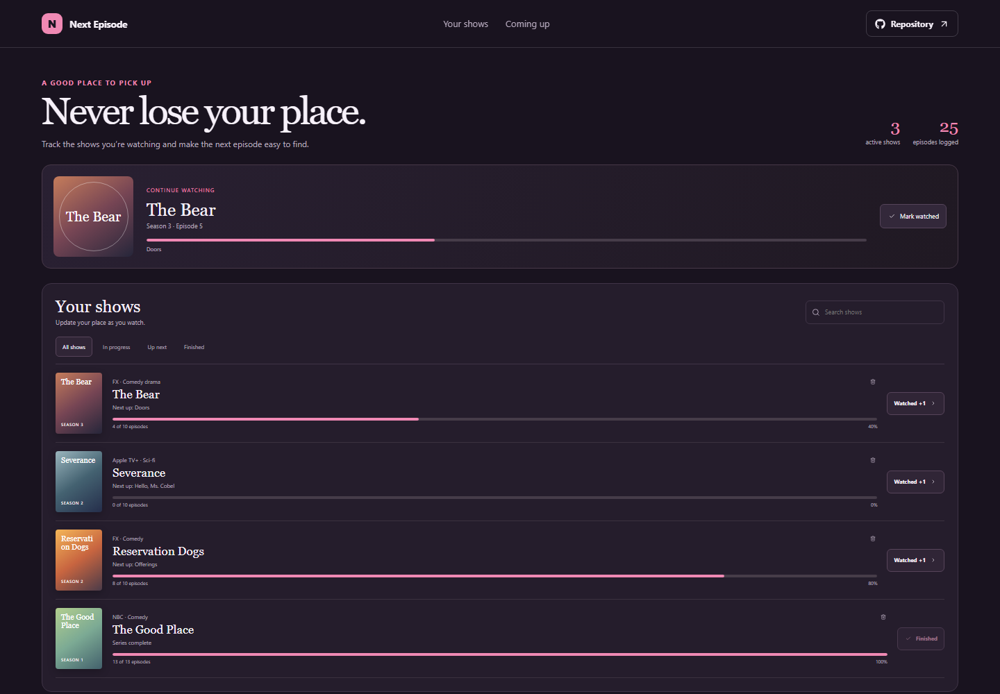

# TV Series Progress Tracker

Next Episode records the season and episode progress for series in progress, queued for later, or already complete.

**Live site:** [https://a2rp.github.io/tv-series-progress-tracker/](https://a2rp.github.io/tv-series-progress-tracker/)

## Interface

A continue-watching panel highlights the next show to resume. The show list has search and status filters. Each series card displays season, next episode, episode counts, a progress bar, and a watched action.

## Features and use

Select Watched +1 on a series to log its next episode. Add a series and the episode count for its current season to create a new entry. Search by title or service and use the filters to find active, upcoming, or finished shows. Remove a show with the trash button and confirm.

## Data and limits

Show names, current-season episode counts, and watched progress are saved in localStorage. Sample entries include a next-episode label; newly added entries start at Episode 1.

## Run locally

Use Node.js and npm, then run these commands from the project folder:

```sh
npm install
npm run dev
```

Run ESLint and create a production build with:

```sh
npm run lint
npm run build
```

## Deployment

The public app is published with GitHub Pages. Build and publish the current version with:

```sh
npm run deploy
```

Vite builds with the /tv-series-progress-tracker/ project-page base path.

## Future improvements

These are ideas and are not implemented yet:

- Track multiple seasons and keep a full episode history.
- Add premiere dates and calendar reminders for upcoming releases.

## Links

- Portfolio: [https://www.ashishranjan.net](https://www.ashishranjan.net)
- GitHub: [https://github.com/a2rp](https://github.com/a2rp)
- CodePen: [https://codepen.io/ash1198](https://codepen.io/ash1198)
- LinkedIn: [https://www.linkedin.com/in/aashishranjan](https://www.linkedin.com/in/aashishranjan)
- Facebook: [https://www.facebook.com/theash.ashish/](https://www.facebook.com/theash.ashish/)
- YouTube: [https://www.youtube.com/@ashishranjan-ashz?sub_confirmation=1](https://www.youtube.com/@ashishranjan-ashz?sub_confirmation=1)
- Email: [mailto:ash.ranjan09@gmail.com](mailto:ash.ranjan09@gmail.com)

## Support

- Support: [https://a2rp-donation-page.netlify.app/](https://a2rp-donation-page.netlify.app/)
- Buy Me a Coffee: [https://buymeacoffee.com/ashishranjan](https://buymeacoffee.com/ashishranjan)
- Patreon: [https://www.patreon.com/ashishranjan](https://www.patreon.com/ashishranjan)